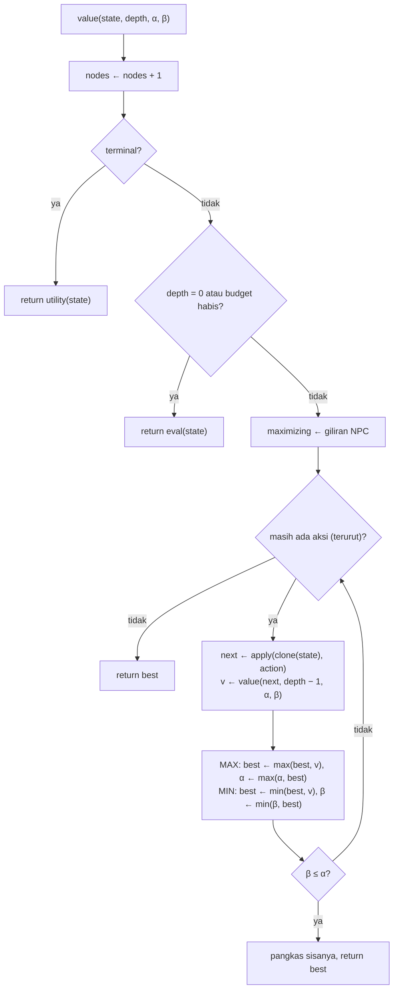

# Laporan AI: Duel Turn-Based dengan Minimax

Proyek: *game AI* (Godot 4.7). Kode AI ada di `scripts/battle/`. Hasil eksperimen lengkap ada di [experiments.md](experiments.md) dan dibuat ulang dengan:

```bash
godot --headless --path . res://tests/experiments_runner.tscn
```

## 1. Alur permainan

1. **Open world** (`main.tscn`). NPC musuh berkeliaran memakai A* (`scripts/core/astar_pathfinder.gd`) dan state machine Idle → Wander → Chase (`scripts/world/world_enemy.gd`). Saat NPC mendekat dan menyentuh player, permainan masuk mode battle.
2. **Battle** (`battle.tscn`). Duel tim 4 vs 4, giliran bergantian: player dulu, lalu NPC. Tiap giliran hanya **satu** unit yang bertindak. NPC memilih aksinya dengan minimax.

## 2. Definisi formal

Semua definisi diimplementasikan di `scripts/battle/battle_sim.gd` (model murni, tanpa node Godot, sehingga bisa di-clone ribuan kali oleh pencarian).

### State

```
S = (units, side_to_move, turn, potions)
unit  = (id, hp, shield, ult, burn, stun, stun_immune)   untuk tiap unit kedua tim
potions = (potion_player, potion_npc)                     stok potion tiap tim
```

HP player dan HP NPC yang diminta soal ada di dalam `units` (bisa dijumlahkan dengan `total_hp(side)`); atribut lain adalah perluasan (asumsi sendiri) yang membuat keputusan lebih menarik.

### Action

Satu aksi = satu unit memakai satu skill ke target: `BattleAction(unit, skill, targets)`. Pada mode dasar (**rule targeting**) target ditentukan aturan tetap, sehingga **branching ≤ jumlah unit hidup yang tidak stun ≤ 4**. Aturan target untuk skill damage bisa dipilih (`target_rule`):

* **WEAKEST**: lawan dengan HP terendah (fokus mengeliminasi).
* **THREAT**: lawan dengan nilai ancaman tertinggi menurut model ancaman di bawah.
* **TOUGHEST**: lawan dengan HP tertinggi (menyebar damage; cocok untuk burn yang butuh waktu).
* **PER_UNIT** (default di game): tiap musuh memakai preferensinya sendiri (`UnitData.preferred_target`): Evil Bamboo dan Bomber → weakest, Bear dan Evil Thunder Mage → threat, Evil Fire Mage → toughest. Dengan ini musuh tidak semuanya mengeroyok satu hero dan targetnya tidak mudah ditebak.

Untuk semua aturan selain WEAKEST, target yang bisa dibunuh saat itu selalu diambil lebih dulu.

Heal selalu ke sekutu terluka dengan rasio HP terendah, shield ke sekutu dengan HP terendah. Padanan dengan soal:

| Soal | Di game |
| --- | --- |
| attack | Kunai Strike, Scorch, Bump, Bite, Bomb, Burn, ... (skill damage) |
| defend | Guard (shield 10) |
| potion | Heal / Blessing (memakai stok potion, 3 per tim) |

Jika tidak ada unit yang bisa bertindak (semua stun), satu-satunya aksi adalah **Pass**.

Mode tambahan **full targeting** (`full_targeting = true`) membuat tiap target sah menjadi aksi terpisah (branching ≤ unit × target ≈ 16), dipakai pada eksperimen 8.

### Transition

`BattleSim.apply(action)`: jalankan skill (damage → shield dulu baru HP; heal; shield; burn; stun), isi ultimate bar +25 kalau mengenai target, kurangi potion untuk heal dasar, akhiri giliran (stun berkurang, unit yang baru lepas stun kebal stun 1 giliran), pindah `side_to_move`, lalu unit yang terbakar di pihak berikutnya menerima 2 damage.

### Terminal test

`is_terminal()` benar jika salah satu tim tidak punya unit hidup, atau `turn ≥ max_turns` (80; batas ini menjamin pohon berhingga dan dihitung seri).

### Utility (hanya di state terminal, dari sudut pandang NPC)

```
U(S) = +1000 + sisa HP NPC      jika NPC menang
U(S) = −(1000 + sisa HP player) jika player menang
U(S) = 0                        jika seri
```

Bonus sisa HP membuat kemenangan cepat/sehat lebih disukai daripada kemenangan lambat. Skala 1000 menjamin utility selalu mendominasi nilai evaluasi.

### Evaluation function (state non-terminal, `scripts/battle/battle_evaluator.gd`)

Dengan bobot personality `w` (own_hp, enemy_hp, own_status, enemy_status):

* **E1 `hp_diff`**: `w_own · HP_npc − w_enemy · HP_player`.
* **E2 `hp_ratio`**: `200 · (w_own · HP_npc/HPmax_npc − w_enemy · HP_player/HPmax_player) + 30 · (jumlah unit hidup NPC − player)`. Membunuh unit dihargai lebih dari sekadar menyebar damage.
* **E3 `tactical`**: E2 ditambah nilai situasi taktis dalam "setara HP": `+0.8·shield`, `−2·burn`, `−6·stun`, `+0.04·ult`, `+4·potion` untuk unit/tim sendiri dan dikurangkan untuk lawan.
* **E4 `threat`**: E3 ditambah `3 · Σ threat(u)` untuk unit sendiri yang hidup dan dikurangi `3 · Σ threat(u)` untuk unit lawan yang hidup. Menghabisi lawan yang berbahaya bernilai lebih tinggi daripada menghabisi lawan yang lemah walau biayanya sama.

**Model ancaman** (`BattleSim.threat_of`): nilai yang diharapkan dari satu aksi unit, dalam setara HP:

```
threat(u) = rata-rata nilai skill dasar + nilai ultimate · (ult / 100)
nilai skill = power (+ 0.5·power_if_burning) + 2·burn_turns + 0.8·heal + 0.8·shield + 6·stun_turns
              dikalikan jumlah target hidup untuk skill AoE
```

Contoh pada awal battle: Ninja 10 (Kunai Strike), Flame 9 (5 + burn 2×2), Monk 4 (heal 5×0.8), Knight 3 (stun hanya dihitung jika HP < 50 %). Ninja dengan bar penuh: 10 + 5×4 = 30.

Semua evaluasi berada di (−1000, 1000).

### Personality (tingkah laku NPC)

| Personality | own_hp | enemy_hp | own_status | enemy_status |
| --- | --- | --- | --- | --- |
| balanced | 1.0 | 1.0 | 1.0 | 1.0 |
| aggressive | 0.4 | 2.0 | 0.4 | 2.0 |
| defensive | 2.0 | 0.4 | 2.0 | 0.4 |

## 3. Algoritma pencarian (`scripts/battle/minimax_ai.gd`)

* **Minimax** penuh sampai kedalaman `d` (1 ply = 1 aksi; giliran NPC = MAX, giliran player = MIN).
* **Alpha-beta pruning** dengan jendela (α, β); cabang yang dipangkas dihitung (`pruned`).
* **Move ordering**: `none` (urutan generasi), `heuristic` (urutkan berdasarkan evaluasi 1-ply, terbaik dulu untuk MAX, terburuk dulu untuk MIN), `random`, `worst` (kebalikan heuristic, sebagai kontrol negatif).
* **Early stop / node budget**: jika jumlah node melewati `node_limit`, node sisanya dievaluasi statis, bukan diekspansi (flag `cutoff`).
* **Expectimax**: jika `hit_chance < 1`, aksi damage menjadi chance node dengan nilai `p·V(kena) + (1−p)·V(meleset)`. Alpha-beta/minimax pada permainan stokastik mengasumsikan selalu kena.
* **Greedy** = kedalaman 1 (baseline).

Setiap keputusan mengembalikan `SearchResult`: aksi terpilih, skor semua aksi akar (ditandai `<=` bila hanya batas atas karena pruning), jumlah node, jumlah evaluasi, cabang dipangkas, waktu.

### 3.1 Struktur algoritma

Tiga fungsi di `minimax_ai.gd`: `decide` (akar, menyimpan skor semua aksi akar untuk overlay), `value` (rekursi minimax/alpha-beta), dan `action_value` (menerapkan satu aksi pada salinan state; pada expectimax menjadi chance node). Satu ply = satu aksi, jadi kedalaman 4 = NPC, player, NPC, player.

```
DECIDE(state):
    best ← none, bestValue ← −∞, α ← −∞
    for action in ORDER(LEGAL_ACTIONS(state, NPC)):
        v ← ACTION_VALUE(state, action, depth − 1, α, +∞)
        catat (action, v)                        # ditampilkan di overlay
        if v > bestValue: bestValue ← v, best ← action
        if alpha-beta: α ← max(α, bestValue)
    return best

VALUE(state, depth, α, β):
    nodes ← nodes + 1
    if TERMINAL(state):             return UTILITY(state, NPC)
    if depth = 0 or nodes ≥ budget: return EVAL(state, NPC)
    maximizing ← (state.side_to_move = NPC)
    best ← maximizing ? −∞ : +∞
    for action in ORDER(LEGAL_ACTIONS(state)):
        v ← ACTION_VALUE(state, action, depth − 1, α, β)
        if maximizing: best ← max(best, v), α ← max(α, best)
        else:          best ← min(best, v), β ← min(β, best)
        if alpha-beta and β ≤ α: break           # pangkas aksi sisanya
    return best

ACTION_VALUE(state, action, depth, α, β):
    if expectimax and CHANCE(action):
        hit  ← VALUE(APPLY(CLONE(state), action, kena),    depth, −∞, +∞)
        miss ← VALUE(APPLY(CLONE(state), action, meleset), depth, −∞, +∞)
        return p·hit + (1 − p)·miss
    return VALUE(APPLY(CLONE(state), action, kena), depth, α, β)
```



Catatan: setiap rekursi bekerja pada salinan state (tidak ada undo); pengurutan aksi dilakukan di setiap node dan biayanya tercatat sebagai `evals`; utility (≥ ±1000) selalu mengalahkan evaluasi (< ±1000); di akar tidak ada pemangkasan, tetapi aksi yang subtree-nya terpotong oleh α hanya memberi batas atas (ditandai `<=` di overlay).

## 4. Debug overlay (tekan **F1** saat battle)

* Daftar aksi yang dipertimbangkan NPC beserta skornya; aksi terpilih disorot.
* Node, evaluasi, cabang dipangkas, waktu keputusan terakhir, dan total kumulatif.
* Kontrol langsung: algoritma, kedalaman, evaluasi, personality, ordering, node limit, mode ultimate, hit chance, aturan target (weakest/threat/toughest/per_unit), full targeting.
* Tombol **Compare algorithms on current state**: menjalankan minimax, alpha-beta, alpha-beta+ordering, dan alpha-beta dengan budget pada state yang sama, menampilkan node count masing-masing.

## 5. Asumsi dan fitur tambahan

1. Satu aksi per giliran per tim (branching ≤ 4), bukan semua unit bertindak; ini "mana" paling sederhana.
2. Target dipilih aturan tetap pada mode dasar (WEAKEST, THREAT, TOUGHEST, atau PER_UNIT); pilihan target dieksplorasi oleh pencarian hanya pada mode full targeting. Evaluasi `threat` tanpa full targeting hanya mengubah *unit mana* yang bertindak, bukan targetnya, karena itu aturan THREAT disediakan terpisah.
3. Potion terbatas 3 per tim; heal dasar memakai potion, ultimate tidak.
4. Burn tidak menumpuk (ambil durasi terpanjang); burn memberi 2 damage di awal giliran unit yang terbakar.
5. Stun: unit tidak bisa dipilih bertindak selama `stun` giliran; setelah lepas, kebal stun 1 giliran (mencegah stun-lock tak terbatas yang ditemukan saat eksperimen awal).
6. Ultimate bar +25 per aksi yang mengenai target; mode `auto` (bar penuh → ultimate otomatis, branching ≤ 4) atau `choice` (basic dan ultimate keduanya ditawarkan).
7. Batas 80 aksi → seri.
8. Permainan deterministik kecuali `hit_chance < 1` dinyalakan untuk eksperimen expectimax.
9. Player selama eksperimen diwakili kebijakan tetap: alpha-beta kedalaman 2 dengan evaluasi `tactical`; HP awal party diacak 70–100 % dengan seed tetap agar tiap konfigurasi menghadapi 30 pertandingan yang identik.
10. Balancing HP (hero 22/20/32/20, musuh 45/60/40/45/45) dipilih sendiri karena spesifikasi hanya memberi nilai damage.

## 6. Hasil eksperimen dan analisis

Dihasilkan oleh `tests/experiments.gd`. Lawan (pihak player) selalu dikendalikan oleh kebijakan tetap: alpha-beta kedalaman 2 dengan evaluasi `tactical` (pemain yang cukup kompeten). Setiap konfigurasi dimainkan pada 30 pertandingan (3 encounter, HP awal party diacak 70-100% dengan seed tetap).

Posisi uji: 40 state tengah-permainan (giliran NPC) yang diambil merata dari 6 pertandingan alpha-beta (depth 3) vs kebijakan player.

## 1. Minimax vs Alpha-Beta vs Early Stop (kedalaman 4)

| Algoritma | Node/keputusan | Evaluasi/keputusan | Cabang dipangkas | Waktu (ms) | Aksi sama dgn minimax | Nilai sama | Budget tercapai |
| --- | --- | --- | --- | --- | --- | --- | --- |
| minimax | 61 | 41 | 0 | 5.0 | 40/40 | 40/40 | 0 |
| alpha-beta (tanpa ordering) | 29 | 15 | 9 | 2.33 | 40/40 | 40/40 | 0 |
| alpha-beta + heuristic ordering | 25 | 43 | 10 | 4.34 | 40/40 | 40/40 | 0 |
| alpha-beta + ordering, budget 150 node | 25 | 43 | 10 | 4.34 | 40/40 | 40/40 | 0 |
| alpha-beta + ordering, budget 60 node | 24 | 41 | 9 | 4.08 | 38/40 | 36/40 | 4 |

## 3. Urutan aksi pada alpha-beta (kedalaman 4)

| Ordering | Node/keputusan | Cabang dipangkas | Waktu (ms) |
| --- | --- | --- | --- |
| none | 29 | 9 | 2.31 |
| heuristic | 25 | 10 | 4.29 |
| random | 36 | 9 | 2.98 |
| worst | 60 | 1 | 8.99 |

## 4. Kedalaman pencarian (alpha-beta + ordering; win rate diukur dengan full targeting agar pilihan target ikut dicari)

| Depth | Node/keputusan | Waktu (ms) | Win rate NPC | Rata-rata giliran | Sisa HP NPC |
| --- | --- | --- | --- | --- | --- |
| 1 | 3 | 0.28 | 70% | 32.4 | 56.2 |
| 2 | 6 | 0.85 | 67% | 32.7 | 57.8 |
| 3 | 13 | 1.95 | 67% | 30.4 | 54.8 |
| 4 | 25 | 4.42 | 70% | 32.3 | 61.4 |
| 5 | 46 | 8.41 | 67% | 28.0 | 61.3 |
| 6 | 86 | 19.6 | - | - | - |

## 2. Fungsi evaluasi (alpha-beta, kedalaman 4, full targeting)

| Evaluasi | Win rate NPC | Seri | Rata-rata giliran | Sisa HP NPC | Sisa HP player | Aksi beda dari tactical | Damage langsung rata-rata | Serangan ke hero paling berbahaya |
| --- | --- | --- | --- | --- | --- | --- | --- | --- |
| hp_diff | 67% | 0 | 30.6 | 68.1 | 3.8 | 11/40 | 4.8 | 19/32 |
| hp_ratio | 73% | 0 | 32.5 | 63.3 | 4.1 | 2/40 | 4.2 | 19/36 |
| tactical | 70% | 0 | 32.3 | 61.4 | 4.1 | 0/40 | 4.2 | 20/36 |
| threat | 67% | 0 | 31.5 | 56.5 | 4.7 | 7/40 | 4.2 | 22/36 |

## 5. Tingkah laku NPC: personality (evaluasi tactical, kedalaman 4, full targeting)

| Personality | Win rate NPC | Rata-rata giliran | Damage ke player | Sisa HP NPC | Sisa HP player | Aksi beda dari balanced | Damage langsung rata-rata | Aksi AoE |
| --- | --- | --- | --- | --- | --- | --- | --- | --- |
| balanced | 70% | 32.3 | 75.9 | 61.4 | 4.1 | 0/40 | 4.2 | 4/40 |
| aggressive | 67% | 28.1 | 75.4 | 56.4 | 4.6 | 7/40 | 4.5 | 7/40 |
| defensive | 70% | 35.4 | 75.9 | 60.9 | 4.1 | 1/40 | 4.4 | 5/40 |

## 6. Expectimax pada permainan stokastik (peluang serangan kena = 0.75, kedalaman 3, full targeting)

| Algoritma | Win rate NPC | Rata-rata giliran | Sisa HP NPC | Node/keputusan | Waktu (ms) | Aksi beda dari alpha-beta |
| --- | --- | --- | --- | --- | --- | --- |
| alpha-beta (mengasumsikan selalu kena) | 70% | 40.2 | 53.7 | 71 | 17.5 | 0/40 |
| expectimax | 70% | 39.8 | 52.7 | 3746 | 419.33 | 2/40 |

## 7. Fitur sendiri: mode ultimate AUTO vs CHOICE (alpha-beta, kedalaman 4)

| Mode | Branching rata-rata (akar) | Node/keputusan | Win rate NPC | Rata-rata giliran |
| --- | --- | --- | --- | --- |
| auto | 2.0 | 25 | 67% | 32.3 |
| choice | 2.42 | 31 | 67% | 30.5 |

## 8. Fitur sendiri: target berdasarkan aturan vs full targeting (alpha-beta, kedalaman 4)

| Targeting | Branching rata-rata (akar) | Node/keputusan | Waktu (ms) | Win rate NPC | Seri | Rata-rata giliran |
| --- | --- | --- | --- | --- | --- | --- |
| rule | 2.0 | 25 | 4.43 | 67% | 0 | 32.3 |
| full | 5.15 | 225 | 76.95 | 70% | 0 | 32.3 |

## 9. Fitur sendiri: aturan target WEAKEST / THREAT / TOUGHEST / PER_UNIT (alpha-beta, kedalaman 4, rule targeting)

Aturan target menentukan siapa yang diserang saat pilihan target tidak dicari. THREAT memakai model ancaman `threat_of`; TOUGHEST menyerang HP tertinggi; PER_UNIT memberi tiap musuh preferensinya sendiri (Bamboo/Bomber: weakest, Bear/Thunder Mage: threat, Fire Mage: toughest). Kill yang tersedia selalu diambil lebih dulu. Kolom terakhir kedua mengukur seberapa sering serangan jatuh ke hero paling berbahaya.

| Konfigurasi | Win rate NPC | Rata-rata giliran | Sisa HP NPC | Sisa HP player | Serangan ke hero paling berbahaya | Aksi beda dari weakest+tactical |
| --- | --- | --- | --- | --- | --- | --- |
| weakest + tactical | 67% | 32.3 | 47.3 | 8.4 | 24/36 | 0/40 |
| threat + tactical | 67% | 30.5 | 45.6 | 12.3 | 31/34 | 0/40 |
| threat + threat | 67% | 30.3 | 42.8 | 13.1 | 31/34 | 1/40 |
| toughest + tactical | 67% | 21.1 | 53.2 | 12.8 | 12/33 | 0/40 |
| per_unit + tactical | 67% | 30.6 | 48.1 | 9.5 | 28/33 | 0/40 |


_Total waktu eksperimen: 818.7 detik._

### Catatan pembacaan

Dengan 30 pertandingan per konfigurasi, satu pertandingan = 3,3 %, sehingga selisih win rate di bawah ±7 % tidak signifikan. Karena permainan deterministik dan lawan tetap, dua konfigurasi yang memilih aksi sama akan menghasilkan 30 pertandingan yang persis sama; itulah sebabnya kolom **"Aksi beda"** (diukur pada 40 posisi uji) sering lebih informatif daripada win rate.

### 6.1 Minimax vs alpha-beta vs early stop (eksperimen 1)

* Alpha-beta memberi **aksi dan nilai yang identik** dengan minimax pada 40/40 posisi (sesuai teori: pruning tidak mengubah hasil), tetapi hanya memerlukan **29 node vs 61 node** per keputusan (−52 %) dan waktu 2,1 ms vs 4,6 ms.
* Budget 150 node tidak pernah tercapai pada kedalaman 4 (pohon kecil karena branching ≤ 4), jadi hasilnya sama persis dengan tanpa budget. Budget 60 node tercapai pada 4 posisi dan di sana pencarian dipotong: nilai berbeda pada 4/40 posisi dan aksi berbeda pada 2/40. Early stop menukar sedikit kualitas dengan jaminan waktu.
* Overlay F1 → tombol *Compare* menunjukkan angka yang sama secara langsung pada state yang sedang dimainkan.

### 6.2 Urutan aksi (eksperimen 3)

* `worst` (kontrol negatif) hampir meniadakan pruning: 60 node, hanya 1 cabang dipangkas, waktu 8,4 ms — hampir sama dengan minimax murni.
* `heuristic` memangkas paling banyak (25 node) tetapi **lebih lambat** dari `none` (4,0 ms vs 2,2 ms) karena pengurutan sendiri memerlukan evaluasi 1-ply tambahan pada setiap node interior (kolom evaluasi/keputusan naik dari 15 ke 43). Pada pohon sekecil ini biaya ordering melebihi penghematannya; pada kedalaman 6 (86 node) selisihnya mulai menguntungkan ordering. `random` berada di tengah.
* Kesimpulan: manfaat ordering bergantung pada rasio biaya ordering terhadap ukuran pohon; untuk branching ≤ 4 dan depth ≤ 4, ordering berdasarkan urutan generasi (unit terkuat lebih dulu) sudah cukup.

### 6.3 Kedalaman (eksperimen 4)

* Node tumbuh eksponensial mendekati faktor ~1,9 per ply (3 → 6 → 13 → 25 → 46 → 86), lebih kecil dari branching rata-rata 2,0–2,4 berkat pruning. Kedalaman 6 masih 16 ms per keputusan, jadi batas praktis di game ini jauh di atas kebutuhan; kedalaman dibatasi 8 pada overlay.
* Win rate **tidak** naik dengan kedalaman (67–70 %). Penyebabnya: (1) hampir semua aksi NPC adalah serangan, dan aksi terbaik sering terlihat sudah di 1 ply; (2) evaluasi didominasi HP sehingga pencarian lebih dalam hanya mengonfirmasi perbedaan yang sudah tampak; (3) hasil pertandingan sangat ditentukan HP awal party (diacak 70–100 %). Diagnosis awal menunjukkan depth 1 dan depth 5 memilih aksi yang berbeda pada ~17 % posisi, tetapi perbedaan itu jarang mengubah pemenang.
* Yang berubah adalah gaya: kedalaman 5 menyelesaikan pertandingan paling cepat (28,0 giliran) dan menyisakan HP NPC tertinggi (61) — pencarian dalam menemukan urutan eliminasi yang lebih efisien.

### 6.4 Fungsi evaluasi (eksperimen 2)

* `hp_diff` memilih aksi berbeda dari `tactical` pada 11/40 posisi dan memberi damage langsung tertinggi (4,8/aksi): karena hanya menghitung selisih HP mentah, ia mengejar damage terbesar dan mengabaikan shield/burn/stun/potion, sehingga pertandingannya paling singkat (30,6 giliran) tetapi win rate terendah (67 %).
* `hp_ratio` dan `tactical` hampir selalu sepakat (2/40 beda). Bonus unit hidup pada keduanya mendorong NPC menghabisi unit lemah, yang lebih efektif daripada damage mentah.
* `threat` (E4) memilih aksi berbeda dari `tactical` pada 7/40 posisi dan paling sering mengarahkan serangan ke hero paling berbahaya (22/36 vs 20/36); karena full targeting aktif, di sini pilihan target memang dicari oleh minimax, bukan aturan. Harganya: pertandingan lebih singkat (31,5 giliran) tetapi sisa HP NPC terendah (56,5) — mengejar Ninja (22 HP) lebih mahal daripada menghabisi Flame (20 HP), dan sementara itu damage tetap masuk.
* Selisih win rate (67–73 %) masih dalam batas noise; perbedaan yang bisa dipercaya adalah perilaku (kolom aksi beda, damage langsung, serangan ke hero paling berbahaya), bukan hasil akhir.

### 6.5 Tingkah laku NPC (eksperimen 5)

* `aggressive` memilih aksi berbeda dari `balanced` pada 7/40 posisi, lebih sering memakai serangan AoE (7/40 vs 4/40), damage langsung rata-rata lebih tinggi (4,5 vs 4,2), dan mengakhiri pertandingan **paling cepat (28,1 giliran)** dengan sisa HP NPC terendah (56) — ia menukar keselamatan dengan tempo.
* `defensive` hampir identik dengan `balanced` (1/40 beda) karena tim NPC tidak punya skill bertahan (heal/shield); satu-satunya cara "bertahan" adalah membunuh penyerang, sehingga bobotnya jarang mengubah pilihan. Pertandingannya paling lama (35,4 giliran).
* Pelajaran: personality lewat bobot evaluasi hanya efektif jika ruang aksi memang memuat pilihan bertahan; untuk NPC yang murni ofensif, perbedaan bobot hanya menggeser pemilihan target.

### 6.6 Expectimax (eksperimen 6, opsional)

* Pada `hit_chance = 0,75`, expectimax menilai kedua hasil (kena/meleset) setiap aksi damage, sehingga node melonjak **53×** (3.746 vs 71) dan waktu 409 ms vs 17 ms per keputusan, karena chance node tidak bisa dipangkas.
* Aksi yang dipilih berbeda hanya pada 2/40 posisi dan win rate sama (70 %): dengan peluang kena tinggi dan serangan yang serupa, nilai ekspektasi mempertahankan urutan preferensi minimax. Expectimax baru berguna ketika ada aksi berisiko tinggi/imbalan tinggi (mis. Detonate 15 vs Bomb 3 ke semua) dan p jauh dari 1.

### 6.7 Fitur sendiri (eksperimen 7 dan 8)

* **Ultimate `choice`** menaikkan branching akar 2,0 → 2,4 dan node 25 → 31; pertandingan lebih singkat (30,5 vs 32,3 giliran) karena NPC boleh menahan ultimate sampai momen yang tepat, tanpa perubahan win rate.
* **Full targeting** menaikkan branching 2,0 → 5,2 dan node 25 → 225 (waktu 4 ms → 77 ms), namun win rate hanya 67 % → 70 %. Aturan target tetap ("serang HP terendah") ternyata sudah hampir optimal; ini membenarkan desain branching ≤ 4 sesuai spesifikasi tugas.

### 6.7b Aturan target per unit (eksperimen 9)

* Kolom "serangan ke hero paling berbahaya" menunjukkan aturan bekerja: WEAKEST 24/36 (tinggi karena hero ber-HP terendah, Flame, kebetulan juga berbahaya), THREAT 31/34, TOUGHEST hanya 12/33, PER_UNIT 28/33 (campuran, sesuai preferensi tiap musuh).
* Kolom "aksi beda dari weakest+tactical" bernilai 0 untuk semua baris karena pada eksperimen ini aturan target diterapkan pada state, sehingga pembanding pun memakai aturan yang sama; kolom itu hanya mengukur pengaruh fungsi evaluasi (1/40 untuk `threat`). Perbedaan antar-aturan terlihat di kolom target dan durasi.
* Win rate identik (67 %) untuk semua aturan: dengan lawan tetap, siapa yang diserang lebih dulu mengubah jalannya pertandingan (sisa HP player 8–13, durasi 21–32 giliran) tetapi tidak pemenangnya. TOUGHEST menghasilkan pertandingan tersingkat (21 giliran) dan sisa HP NPC tertinggi (53); menyebar damage ke Knight ternyata tidak dihukum oleh lawan depth-2 ini. PER_UNIT berada di antara WEAKEST dan THREAT pada semua metrik, dan merupakan default di game karena membuat target tidak mudah ditebak tanpa mengorbankan kekuatan.
* Pelajaran: pada mode branching ≤ 4, kualitas AI terutama ditentukan oleh aturan target yang ditanam, bukan oleh kedalaman pencarian; memindahkan pilihan target ke pencarian (full targeting) menaikkan biaya 9× untuk hasil yang hampir sama.

### 6.8 Kesimpulan

1. Alpha-beta memberikan keputusan yang identik dengan minimax dengan separuh node; move ordering bermanfaat hanya jika biayanya lebih kecil dari pohon yang dipangkas.
2. Early stop berbasis budget node adalah cara aman membatasi waktu: kualitas turun sedikit hanya pada posisi yang benar-benar dipotong.
3. Di game ini kedalaman > 2 tidak menaikkan win rate, tetapi mengubah gaya (lebih cepat, lebih hemat HP). Kedalaman perlu dibatasi bukan karena waktu (16 ms pada depth 6) melainkan karena manfaat marginalnya kecil.
4. Fungsi evaluasi, personality, dan aturan target terlihat jelas pada **perilaku** (aksi yang dipilih, target, tempo, AoE), bukan pada win rate; itulah metrik yang tepat untuk membandingkannya. Evaluasi `threat` dan aturan THREAT/PER_UNIT membuat NPC mengejar hero berbahaya dan tidak lagi selalu mengeroyok Flame.
5. Expectimax benar secara teori tetapi 50× lebih mahal dan hampir tidak mengubah keputusan pada p = 0,75.

